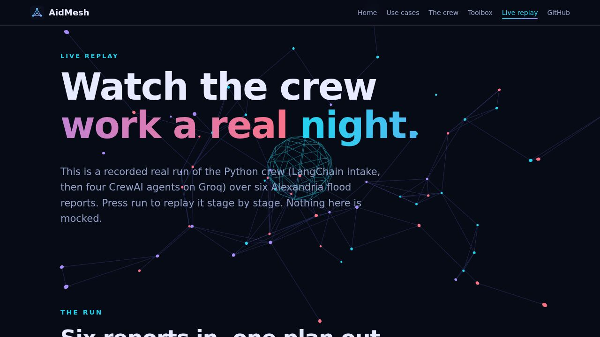
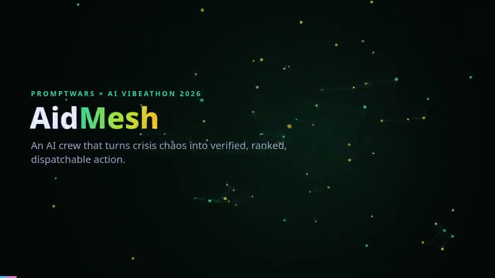
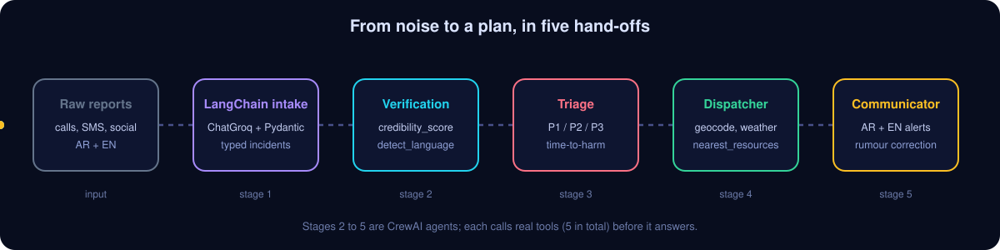
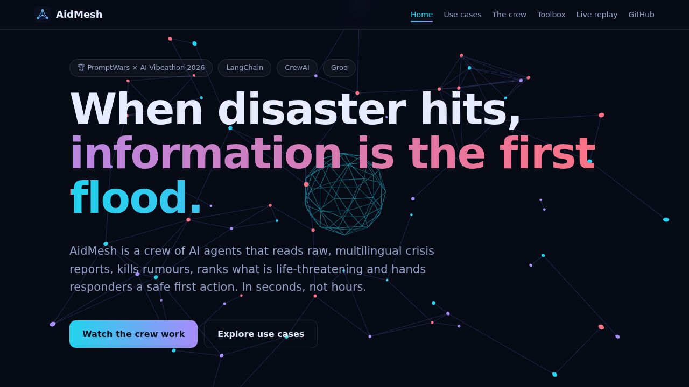
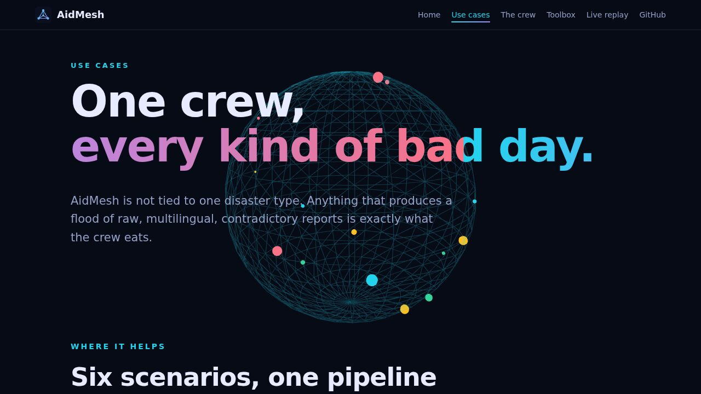
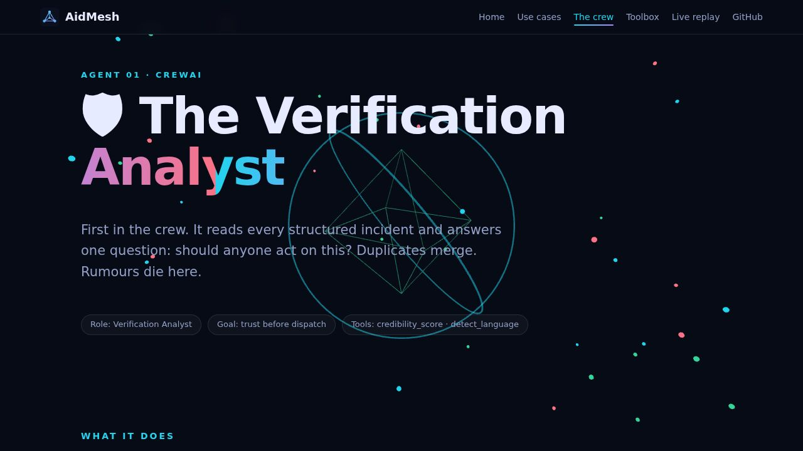
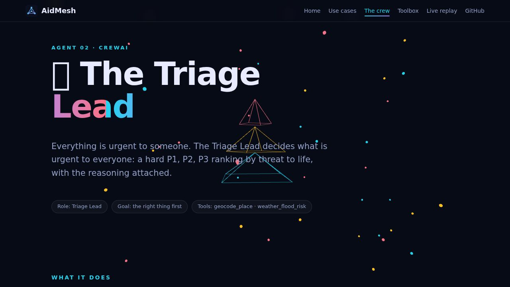
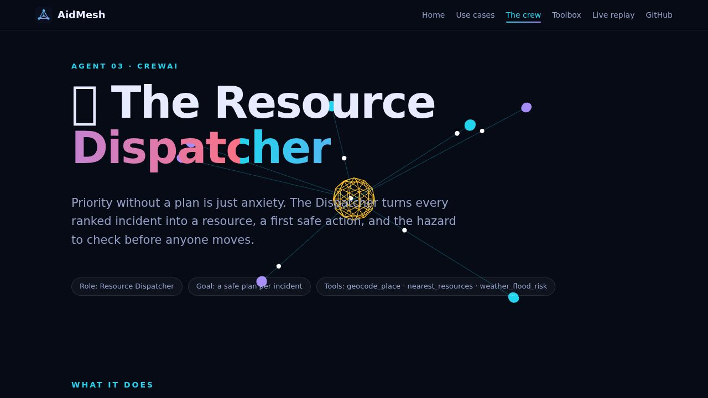
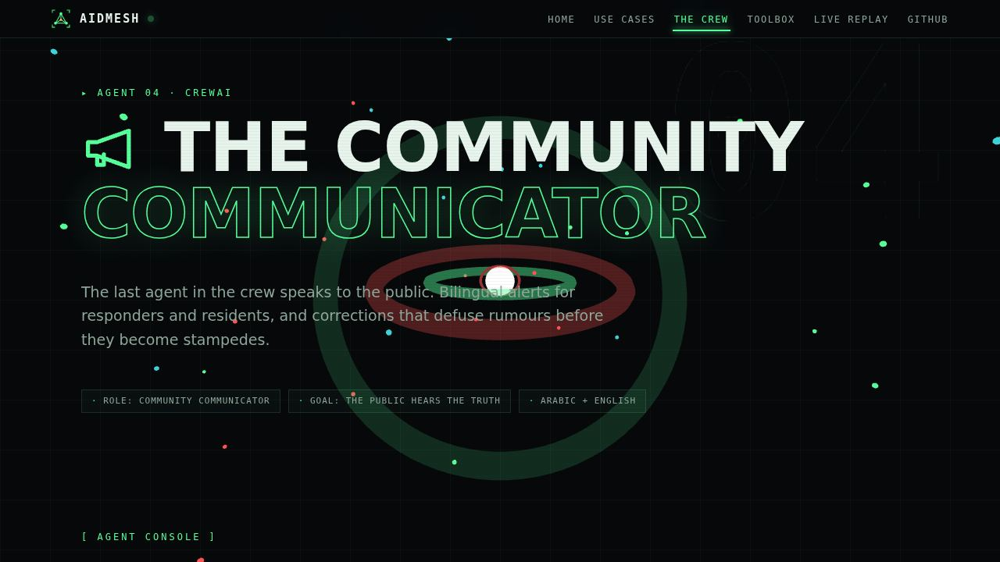
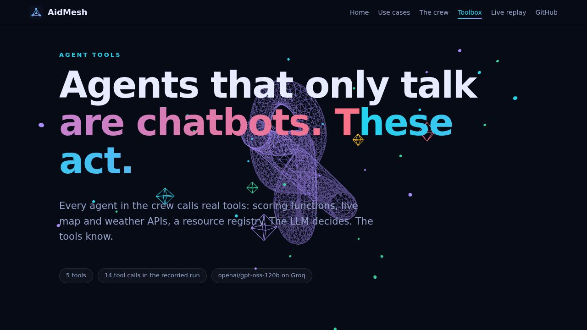

<div align="center">


[](https://aidmesh-production.up.railway.app/)
[](https://python.langchain.com)
[](https://crewai.com)
[](https://groq.com)


**[Open the live 3D site](https://aidmesh-production.up.railway.app/)** &nbsp;|&nbsp; **[Watch the replay](https://aidmesh-production.up.railway.app/demo.html)** &nbsp;|&nbsp; **[Meet the tools](https://aidmesh-production.up.railway.app/tools.html)** &nbsp;|&nbsp; [GitHub Pages mirror](https://alouakhalid.github.io/aidmesh/)

</div>

<p align="center"><br><sub>The replay page: a recorded real run of the crew, with a live mode that calls the hosted API.</sub></p>

---

## Presentation video

[](https://www.linkedin.com/feed/update/urn:li:activity:7531594395373203456/)

90 second walkthrough of the problem, the four agents and a real recorded run, in the [LinkedIn post](https://www.linkedin.com/feed/update/urn:li:activity:7531594395373203456/) (the video is kept out of the repo to stay small). Post text: [docs/linkedin-post.md](docs/linkedin-post.md).

## The problem

In the first hours of a flood, a coordination room receives the same incident five times in two languages, panicked posts mixed with real calls for help, and rumours ("the dam collapsed, thousands dead") that send rescuers to the wrong place. Every minute spent sorting noise is a minute nobody gets rescued.

## What AidMesh does

Raw Arabic and English reports go in. Out comes a plan a coordinator can act on: merged incidents, a rumour label for each, a P1/P2/P3 ranking, the nearest resource with a distance, a first safe action, a hazard to check, and short bilingual alerts including a calm rumour correction.

## Architecture

<p align="center"></p>

| Stage | Framework | Job |
|---|---|---|
| Intake | LangChain (`ChatGroq` + `with_structured_output`) | Turns messy text into typed `Incident` objects: need, location, people affected, life threat, English summary |
| Verification Analyst | CrewAI | Calls `credibility_score` on each report, merges duplicates, labels VERIFIED / UNVERIFIED / RUMOUR |
| Triage Lead | CrewAI | Ranks P1 / P2 / P3 by time-to-harm |
| Resource Dispatcher | CrewAI | Geocodes the place, finds the nearest resource, checks weather, gives first safe action and a hazard check |
| Community Communicator | CrewAI | Arabic and English SMS-length alerts and a rumour correction |

## Agent tools (all real, all tested)

| Tool | What it does | Backed by |
|---|---|---|
| `credibility_score` | 0-100 score with reasons: shouting, "share now", extreme casualty claims, concrete place, checkable numbers, channel | Transparent rules in `aidmesh/tools_core.py` (no LLM) |
| `detect_language` | `ar`, `en`, `mixed` or `unknown` | Unicode script ratio |
| `geocode_place` | Place name to coordinates | OpenStreetMap Nominatim (free, no key) |
| `weather_flood_risk` | Next-24h rain (mm) and river-discharge trend | Open-Meteo forecast and flood APIs (free, no key) |
| `nearest_resources` | Nearest hospital, dialysis, rescue, shelter, electric or water unit by great-circle distance | `data/resources.json`, a **sample registry** of 8 Alexandria entries. Replace with a real civil-defence list |

Network tools time out after 8 seconds and return an error object instead of crashing the crew.

## Real results (recorded run)

One run on the six sample reports in `data/reports.json` (Arabic + English, one rumour), model `openai/gpt-oss-120b` on Groq. The full output is in [`docs/data/run.json`](docs/data/run.json) and is what the website replays.

| Measure | Value |
|---|---|
| Reports in, incidents out | 6 reports, 6 structured incidents, merged to 5 situations |
| Duplicates merged | Arabic call + English social post about the same trapped family |
| Rumour handling | Dam-collapse claim labelled RUMOUR (credibility score 0: shouting, "share now", extreme casualty claim) |
| Tool calls made by the agents | `credibility_score` x5, `geocode_place` x5, `nearest_resources` x3, `weather_flood_risk` x1 |
| Wall-clock time | about 106 seconds for the whole crew (the earlier version without tools took about 25 seconds) |

## The website

A multi-page 3D animated site (Three.js, no build step) hosted on GitHub Pages. Screenshots below were taken from the live site.

| | |
|---|---|
| <br>**Home** | <br>**Use cases** |
| <br>**Verification agent** | <br>**Triage agent** |
| <br>**Dispatcher agent** | <br>**Communicator agent** |
| <br>**Toolbox** | <br>**Live replay** |

## Quick start

```bash
git clone https://github.com/Alouakhalid/aidmesh && cd aidmesh
pip install -r requirements.txt
export GROQ_API_KEY=your_key          # free at https://console.groq.com
python -m aidmesh.cli data/reports.json --out docs/data/run.json
```

Run the API server locally (rate limited, key only from the environment):

```bash
pip install -r requirements-server.txt
uvicorn server.app:app --port 8000
curl -X POST localhost:8000/api/run -H 'content-type: application/json' \
  -d '{"reports":[{"id":"R1","text":"Water 1.5m at Manshiya, family on 2nd floor"}]}'
```

## Live API

The Railway host serves both the website (same origin) and the API, so the site and its backend are one deployment. GitHub Pages is a static mirror that calls the same API.

A small FastAPI backend runs the same crew on demand: **https://aidmesh-production.up.railway.app** (hosted on a Railway trial plan).

```bash
curl https://aidmesh-production.up.railway.app/api/health
curl -X POST https://aidmesh-production.up.railway.app/api/run -H 'content-type: application/json' \
  -d '{"reports":[{"id":"R1","text":"Water 1.5m at Manshiya, family on 2nd floor"}]}'
# -> {"job_id":"...","status":"queued"}; then poll GET /api/job/<job_id> until "done"
```

- Runs are jobs you poll, because a full crew run can take from about 20 seconds (one report) to about 2 minutes (six).
- Limits: at most 6 reports of 400 characters, 4 runs per IP per hour, 150 per day, 3 jobs at once. The Groq key is a host secret, never in the repo or in browser code.
- Hosting is a trial plan with limited credit. If the API is busy or down, the website falls back to the recorded real run.

## Engineering notes

- **Efficiency:** geocoding and weather lookups are cached for 10 minutes, the resource registry is read once, regexes are compiled once, responses are gzip-compressed, static files get a short cache, and one crew run executes at a time with a bounded job queue.
- **Security:** the Groq key lives only in a host secret. Inputs are length-limited, control characters are stripped, ids and sources are validated, requests are rate limited per visitor and per day (with `Retry-After`), API responses are never cached, and security headers are set. Failed runs report only the error type.
- **Quality:** small modules (`limits.py`, `jobs.py`, `tools_core.py`), tool logic in plain testable functions, ruff lint and pytest with coverage in CI.

## Tests

```bash
pip install pytest && pytest -q      # 19 tests, no network and no API key needed
```

They cover language detection, haversine distance, credibility scoring on a rumour versus a specific call, nearest-resource sorting and filtering, geocoding and weather parsing with mocked HTTP and graceful failure, the CrewAI tool wrappers, API input validation, per-IP rate limiting, CORS, and the shape of the recorded run.

## Repo layout

```
aidmesh/
  intake.py       LangChain stage
  crew.py         CrewAI agents, tasks and tool wiring
  tools.py        CrewAI tool wrappers
  tools_core.py   plain-Python tool logic (testable)
  pipeline.py     intake + crew
  llm.py          Groq wiring for both frameworks
  schemas.py      Pydantic incident schema
  cli.py          command line entry
server/app.py     FastAPI backend with rate limiting
data/             sample reports and sample resource registry
docs/             multi-page 3D website (GitHub Pages) and recorded run
tests/            pytest suite
```

## Honest limits

- AidMesh assists coordinators. A human confirms every dispatch.
- The resource registry is sample data. Distances are straight-line, not road routes.
- Nominatim can pick the wrong "Manshiya" for an ambiguous name. In the recorded run the Manshiya rescue unit came out as a farther station for this reason. Always show the coordinates to a human.
- Credibility scores are simple rules, not ground truth. A real rumour can look specific.
- The LLM can add details that did not come from a tool. In the recorded run the dispatcher mentioned a sand-storm hazard that no weather tool returned.
- The crew with tools takes about 1.5 to 2 minutes per run. The website replays a recorded real run and, when the hosted API is reachable, can run the crew live. The hosted API is on a trial plan with limited credit.

- The hosted API runs on a trial plan with limited credit and a per-visitor rate limit. If it is busy or out of credit, the site shows the recorded run and says so.
- The "recorded run" shown by default is one real run on six sample reports; live runs use whatever report you type (one report, max 400 characters on the site).

## License

MIT. See [LICENSE](LICENSE).
