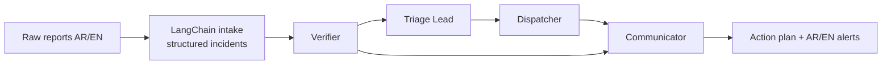

<div align="center">


# AidMesh

### A crew of AI agents that turns crisis chaos into verified, prioritized action.

[](https://alouakhalid.github.io/aidmesh/)
[](https://python.langchain.com)
[](https://crewai.com)
[](https://groq.com)


**PromptWars × AI Vibeathon 2026 submission**

</div>

---

## The problem

During floods and other disasters, response rooms receive a flood of their own: duplicate calls, panicked social posts, Arabic and English mixed together, and rumours that send rescue teams to the wrong place. Humans lose precious minutes sorting noise instead of saving people.

## The solution

AidMesh reads raw multilingual reports and produces, in seconds:

1. **Structured incidents** (LangChain + Pydantic): need, location, people affected, life threat, English summary.
2. **Verification** (CrewAI Verification Analyst): merges duplicates and labels each incident `VERIFIED`, `UNVERIFIED` or `RUMOUR`.
3. **Triage** (CrewAI Triage Lead): P1 / P2 / P3 by time-to-harm.
4. **Dispatch** (CrewAI Resource Dispatcher): resource type, first safe action, hazard to check.
5. **Alerts** (CrewAI Community Communicator): SMS-length Arabic and English messages, including a calm rumour correction.



## Live demo

**https://alouakhalid.github.io/aidmesh/** : a 3D animated site with a step-by-step replay of a real recorded run (`docs/data/run.json`), generated by the code in this repo on 6 sample reports (one of them a rumour about a dam collapse).

## Quick start

```bash
git clone https://github.com/Alouakhalid/aidmesh && cd aidmesh
pip install -r requirements.txt
export GROQ_API_KEY=your_key      # free at console.groq.com
python -m aidmesh.cli data/reports.json --out docs/data/run.json
```

Run tests: `pip install pytest && pytest`

## Project structure

```
aidmesh/
  intake.py    LangChain chain with structured output
  crew.py      CrewAI agents, tasks, sequential process
  llm.py       Groq wiring for both frameworks
  cli.py       entry point
data/reports.json   sample multilingual reports
docs/               3D website (Three.js) + recorded run
tests/              schema test
```

## Honest limits

- AidMesh **assists** dispatchers and never replaces them. A human confirms every dispatch.
- In the recorded run the crew labelled the dam-collapse claim `RUMOUR` correctly, but still ranked it P3 with a recon step. A human should veto that. The verification label is the main safety feature.
- The public website replays a recorded run. It does not expose an API key. Run the CLI with your own key for live results.

## Roadmap

Live ingest from SMS/WhatsApp, map view, human approval queue, evaluation set of real Arabic reports.

## License

MIT
